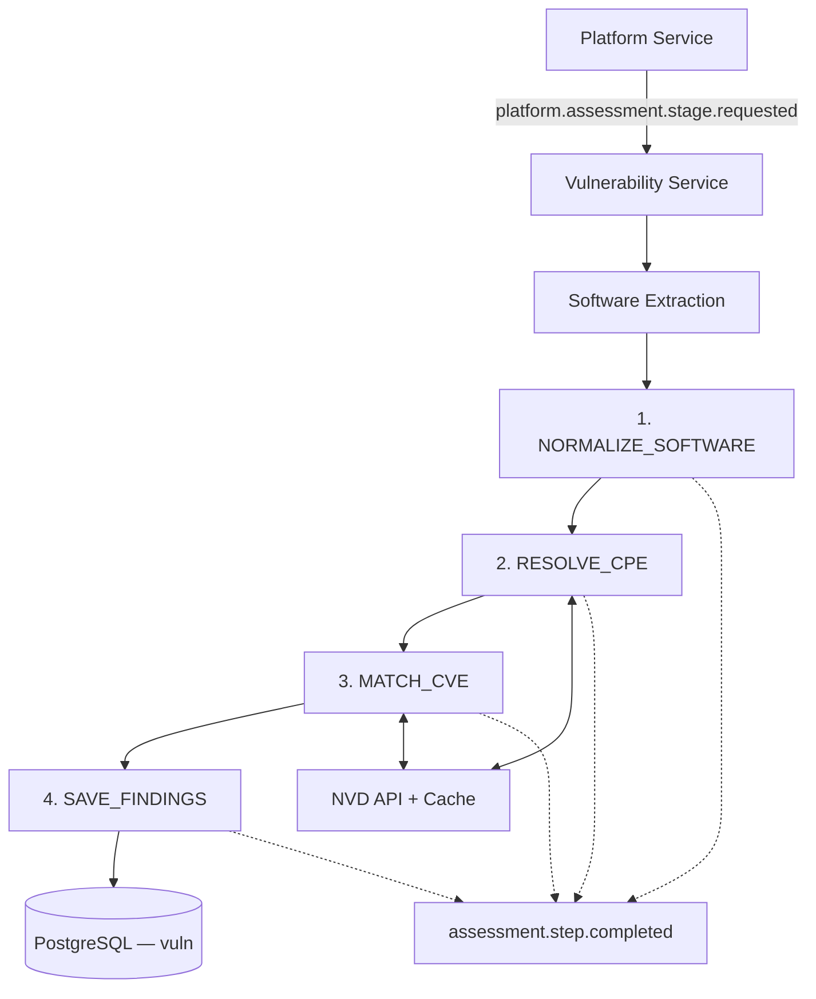
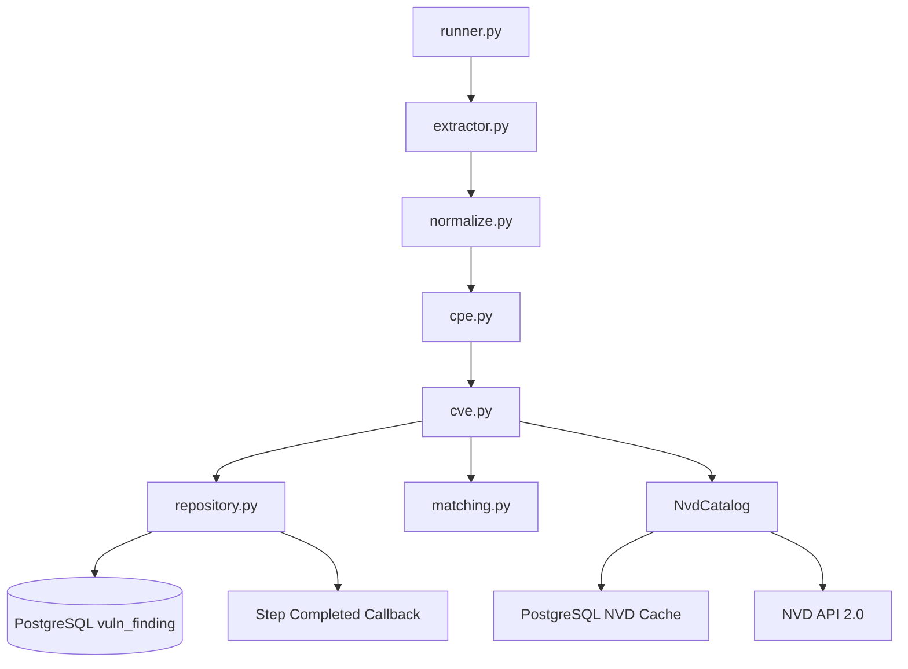

# Tổng kết Module F1 — CVE Matching Engine

Dựa trên quá trình thiết kế, các đoạn code đã xây dựng và source của lan-vuln-service, chúng ta có thể
tổng kết F1 theo ba khía cạnh: nghiệp vụ đã thực hiện, cơ sở lý thuyết và những giới hạn kỹ thuật còn tồn tại.

## 1. Mục tiêu của CVE Matching

Module F1 có nhiệm vụ: Từ thông tin phần mềm, hệ điều hành hoặc firmware mà Discovery Service thu thập được, nhận diện
sản phẩm theo chuẩn CPE, đối chiếu với dữ liệu CVE công khai của NVD và đưa ra danh sách các lỗ hổng có khả năng ảnh
hưởng đến thiết bị.

Module này không thực hiện khai thác lỗ hổng. Kết quả là những CVE candidates kèm bằng chứng, mức độ nghiêm trọng và
trạng thái cần xác minh.

### Workflow tổng thể



## 2. Những chức năng đã xây dựng

| Thành phần                  | Trạng thái trong source | Nhận xét                                                     |
|-----------------------------|-------------------------|--------------------------------------------------------------|
| Common Configuration        | Đã triển khai           | Tách Service, RabbitMQ, Database Config                      |
| Common Database             | Đã triển khai           | Sử dụng SQLAlchemy Engine và Connection Pool                 |
| RabbitMQ Event Bus          | Đã triển khai           | Publish confirm, consumer, ACK/NACK                          |
| Platform Request Validation | Đã triển khai cơ bản    | Đọc đúng `data.inputs` và `data.stage_run_id`                |
| Software Extraction         | Đã triển khai một phần  | Hiện chỉ trích xuất Apache từ HTTP banner                    |
| Software Normalization      | Đã triển khai cơ bản    | Sử dụng alias cố định                                        |
| CPE Resolution              | Đã triển khai V1        | Tạo CPE candidate, chưa tra cứu dictionary trong luồng chính |
| CVE Matching                | Đã triển khai V1        | Kiểm tra version và một số điều kiện applicability           |
| NVD API Integration         | Đã triển khai           | Có HTTP client, pagination, cache                            |
| PostgreSQL Persistence      | Đã triển khai           | Có transaction để lưu findings                               |
| F2 — Misconfiguration       | Mới có khung            | Chưa có thuật toán kiểm tra cấu hình                         |
| F3 — Risk Scoring           | Mới có khung            | Chưa có thuật toán chấm điểm                                 |

## 3. Cơ sở lý thuyết của từng bước

### 3.1. Software Extraction — Service Fingerprinting

Cơ sở lý thuyết: Application Layer Fingerprinting và Banner Grabbing.

Khi một ứng dụng cung cấp dịch vụ mạng, nó có thể tiết lộ thông tin về tên phần mềm hoặc phiên bản thông qua các trường
trong giao thức ứng dụng. Ví dụ dữ liệu Discovery trả về:

```json
{
  "ip": "192.168.56.12",
  "source": "banner",
  "raw_config": "{\"Server\":\"Apache/2.4.52 (Ubuntu)\"}"
}
```

Sau khi parse sẽ thành: `Server: Apache/2.4.52 (Ubuntu)` thì CVE_MATCHING có thể trích xuất các thuộc tính là:

* Product - Apache HTTP Server
* Distribution hint - Ubuntu
* Version - 2.4.52
* Evidence source - HTTP Server Header
* Host - 192.168.56.12

Bước này dựa vào phân tích cú pháp và Pattern Matching, có thể sử dụng Regular Expression `r"Apache/(\d+(?:\.\d+)+)"`

Giới hạn lý thuyết: Banner là thông tin do server công bố, có thể bị thay đổi hoặc giả mạo; nó không phải bằng chứng
tuyệt đối về phiên bản phần mềm thực sự đang chạy.

### 3.2. Software Normalization — Data Normalization

Cơ sở lý thuyết: Canonicalization, Entity Resolution và quy tắc ánh xạ định danh.

Một phần mềm có thể có nhiều tên gọi. Ví dụ Apache HTTP server còn có thể gọi là `Apache httpd`, `Apache HTTP Server`,
`Apache2`. Để có thể tra cứu NVD, engine cần đưa những tên này về định danh chung.

Với mapping đã cấu hình cho Apache HTTP Server trong source code như sau:

```
Raw product: Apache httpd
             |
             v
Vendor: apache
Product: http_server
Version: 2.4.52
```

Trong code hiện tại, normalize() sử dụng bảng PRODUCTS để ánh xạ những tên đã biết sang part, vendor và product. Đây là
cách triển khai Rule-based Normalization: đơn giản, dễ kiểm soát, không cần AI hoặc Machine Learning. Tuy nhiên, bảng
alias vẫn còn nhỏ. Những phần mềm không được khai báo sẽ chưa thể chuẩn hóa thành công.

### 3.3. CPE Resolution — Common Platform Enumeration

Cơ sở lý thuyết: Chuẩn CPE 2.3 của NIST, gồm Naming, Dictionary và Name Matching. CPE cho phép biểu diễn một sản phẩm
công nghệ theo định dạng tiêu chuẩn.

Ví dụ CPE ứng viên của Apache: `cpe:2.3:a:apache:http_server:2.4.52:*:*:*:*:*:*:*` trong đó:

* part - a - Application
* vendor - (apache) - Nhà cung cấp
* product - (http-server) - Tên sản phẩm
* version - (2.4.52) - Phiên bản
* Các field `*` còn lại - Không giới hạn giá trị tương ứng

Trong source code CVE_MATCHING đã thiết kế 2 cách tiếp cận:

* **Cách 1 — Tra cứu CPE Dictionary**: tìm tên CPE chính thức qua NVD API rồi đối chiếu vendor/product/version.
* **Cách 2 — Tạo CPE candidate**: tạo định danh truy vấn từ vendor/product/version đã chuẩn hóa khi không tìm được bản
  ghi phiên bản chính xác trong dictionary. Cách này hỗ trợ tra cứu linh hoạt hơn, nhưng CPE được tạo ra chỉ là ứng
  viên, không mặc nhiên là một bản ghi đã được NVD xác nhận.

### 3.4. CVE Matching — Version Range Matching

Cơ sở lý thuyết: So sánh phiên bản và đánh giá điều kiện thuộc khoảng. Một CVE thường có điều kiện phiên bản bị ảnh
hưởng, chẳng hạn: `"versionStartIncluding": "2.4.0"` , `"versionEndExcluding": "2.4.60"`. Theo ví dụ giả định này, điều
kiện là: $2.4.0 \leq V < 2.4.60$. Với phiên bản thu thập được là $V=2.4.52$ thì kết quả kiểm tra khoảng phiên bản là
TRUE.

NVD sử dụng CPE Match Criteria với các giới hạn bao gồm hoặc loại trừ đầu và cuối khoảng phiên
bản. (https://nvd.nist.gov/developers/products)

#### Thuật toán đã viết

`compare_versions()` xử lý:

* Phiên bản dạng số như 2.4.52.
* Phiên bản OpenSSH như 8.2p1.
* Một số định dạng khác được thư viện packaging.version hỗ trợ.

`check_criterion()` kiểm tra vendor/product và các thuộc tính version range.

Tuy nhiên, kết quả này chưa chứng minh thuật toán xử lý đúng toàn bộ các kiểu version của Debian, RPM hoặc firmware

### 3.5. CVE Applicability — Boolean Logic và Three-valued Logic

Cơ sở lý thuyết: Logic mệnh đề (AND, OR, NOT) và logic ba trạng thái.

## Chức năng của từng file Python trong app/cve_matching

thư mục cve_matching hiện có 8 file Python, trong đó 7 file chứa logic xử lý và 1 file __init__.py để khai báo package.

| File            | Chức năng chính                                    | Hàm quan trọng                                                         |
|-----------------|----------------------------------------------------|------------------------------------------------------------------------|
| `extractor.py`  | Trích xuất thông tin phần mềm từ dữ liệu Discovery | `extract_software()`                                                   |
| `normalize.py`  | Chuẩn hóa tên phần mềm, vendor, version            | `normalize()`                                                          |
| `cpe.py`        | Tạo CPE candidate từ phần mềm đã chuẩn hóa         | `resolve_cpes()`                                                       |
| `matching.py`   | So sánh version, kiểm tra điều kiện CPE, lấy CVSS  | `compare_versions()`, `check_criterion()`, `match_cve()`, `get_cvss()` |
| `cve.py`        | Tra cứu, đối chiếu CVE và tạo danh sách findings   | `match_cves()`, `_match_status()`                                      |
| `repository.py` | Lưu và truy vấn CVE findings trong PostgreSQL      | `save_findings()`, `get_findings()`                                    |
| `runner.py`     | Điều phối toàn bộ pipeline CVE Matching            | `run()`                                                                |
| `__init__.py`   | Đánh dấu thư mục là Python package                 | Không có                                                               |



### `extractor.py` — Software Extraction

Trích xuất tên phần mềm và phiên bản từ JSON do Platform Service gửi.
Sau đó thực hiện:

1. Chọn các snapshot có source="banner".
2. Parse chuỗi raw_config thành JSON.
3. Lấy trường Server.
4. Sử dụng Regular Expression để nhận diện Apache.
5. Trả về danh sách phần mềm đã trích xuất.

Code hiện tại mới hỗ trợ HTTP banner của Apache. Chưa trích xuất OpenSSH, Nginx, firmware OpenWrt hoặc thông tin
devices[].os. Khi không biết cổng, code gán port=0

### `normalize.py` — Software Normalization

Chuẩn hóa tên phần mềm thành định danh vendor/product có thể sử dụng để tạo CPE.

Đang ở việc File sử dụng dictionary PRODUCTS:

```python
PRODUCTS = {
    "openssh": ("a", "openbsd", "openssh"),
    "openssh server": ("a", "openbsd", "openssh"),
    "apache httpd": ("a", "apache", "http_server"),
    "apache http server": ("a", "apache", "http_server"),
    "openssl": ("a", "openssl", "openssl")
}
```

Ví dụ đầu ra:

```
Input:
Apache httpd 2.4.52

Output:
part    = a
vendor  = apache
product = http_server
version = 2.4.52
```

### `cpe.py` — CPE Resolution

Chuyển thông tin phần mềm đã chuẩn hóa thành CPE candidate theo cấu trúc CPE 2.3. Ví dụ:

```
Input:
apache, http_server, 2.4.52

Output:
cpe:2.3:a:apache:http_server:2.4.52:*:*:*:*:*:*:*
```

### `matching.py` — Matching Utilities

Đây là file chứa các thuật toán so khớp cơ bản của F1.

| Hàm                                    | Chức năng                                   |
|----------------------------------------|---------------------------------------------|
| `compare_versions(a, b)`               | So sánh hai phiên bản phần mềm              |
| `check_criterion(criterion, cpe_name)` | Kiểm tra CPE và các điều kiện version range |
| `match_cve(cve, cpe_name)`             | Đánh giá một phần điều kiện CVE             |
| `get_cvss(cve)`                        | Lấy CVSS score và severity                  |

Quy ước:
- -1: phiên bản thứ nhất nhỏ hơn.
- 0: hai phiên bản bằng nhau.
- 1: phiên bản thứ nhất lớn hơn.
- None: không so sánh được.

### cve.py — CVE Matching Engine

Đây là file chứa logic đối chiếu CVE chính của F1.

Nghiệp vụ:
1. Nhận danh sách (software, cpe_name) từ cpe.py.
2. Gọi NvdCatalog.cves(cpe_name) để lấy CVE candidates.
3. Loại bỏ CVE bị từ chối (Rejected).
4. Kiểm tra các điều kiện CPE và version.
5. Xác định trạng thái POTENTIAL hoặc NEEDS_REVIEW.
6. Trích xuất CVSS.
7. Tạo finding chứa host, product, version, CPE, CVE ID và evidence.
8. Loại bỏ finding trùng trên cùng dịch vụ.

### repository.py — CVE Finding Persistence

Thực hiện các thao tác PostgreSQL liên quan đến kết quả CVE Matching.

hàm `save_findings()` thực hiện:
- Lấy scan_id và data.stage_run_id.
- Mở transaction bằng Common Database.
- Xóa findings cũ thuộc cùng stage_run_id.
- Insert toàn bộ findings mới.
- Lưu evidence dưới dạng JSONB.

### Update
```
Ưu tiên	            Chức năng cần bổ sung	                    File ảnh hưởng	                    Lý do
P0	        Đánh giá đầy đủ CPE Applicability	             cve.py, matching.py	    Tránh kết luận sai với cấu hình AND/OR/NOT
P0	        Kiểm tra bản vá nhà cung cấp	                 Module mới	                Tránh báo CVE đã được backport bản vá
P0	        Mở rộng Software Extraction	                     extractor.py	            Hiện chỉ nhận diện Apache HTTP banner
P0	        Thu thập OS, firmware, package version	         extractor.py + Discovery   Nhận diện Windows, Linux, OpenWrt
P0	        Xử lý port không xác định và evidence	         repository.py, database    Tránh lỗi lưu dữ liệu, mất bằng chứng
P1	        CPE Resolution thực sự	                         cpe.py	                    Giảm lỗi định danh vendor/product
P1	        Version Comparator theo từng hệ sinh thái	     matching.py	            Không phải phần mềm nào cũng dùng SemVer
P1	        Xây dựng mức độ tin cậy của finding	             cve.py	                    Phân biệt ứng viên và lỗ hổng có bằng chứng mạnh
P1	        Đồng bộ NVD theo thời gian cập nhật	             app/nvd/	                Giữ dữ liệu CVE mới và cập nhật
P1	        Kiểm thử dữ liệu thật và regression test	     tests/	                    Đo khả năng phát hiện đúng/sai
P2	        Xác minh điều kiện module/configuration	         cve.py + Discovery	        Xác định CVE có thực sự áp dụng
P2	        Cung cấp CWE, advisory, giải pháp khắc phục	     cve.py, repository.py	    Kết quả hữu ích cho người quản trị
P2	        Kết hợp KEV/EPSS	                             F1 output hoặc F3	        Hỗ trợ ưu tiên xử lý lỗ hổng
```