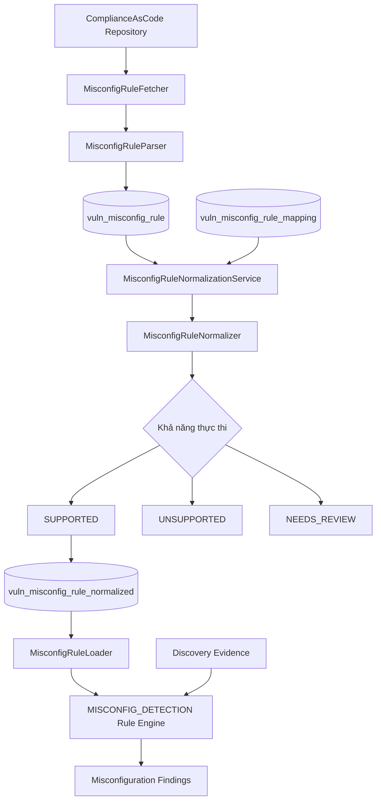
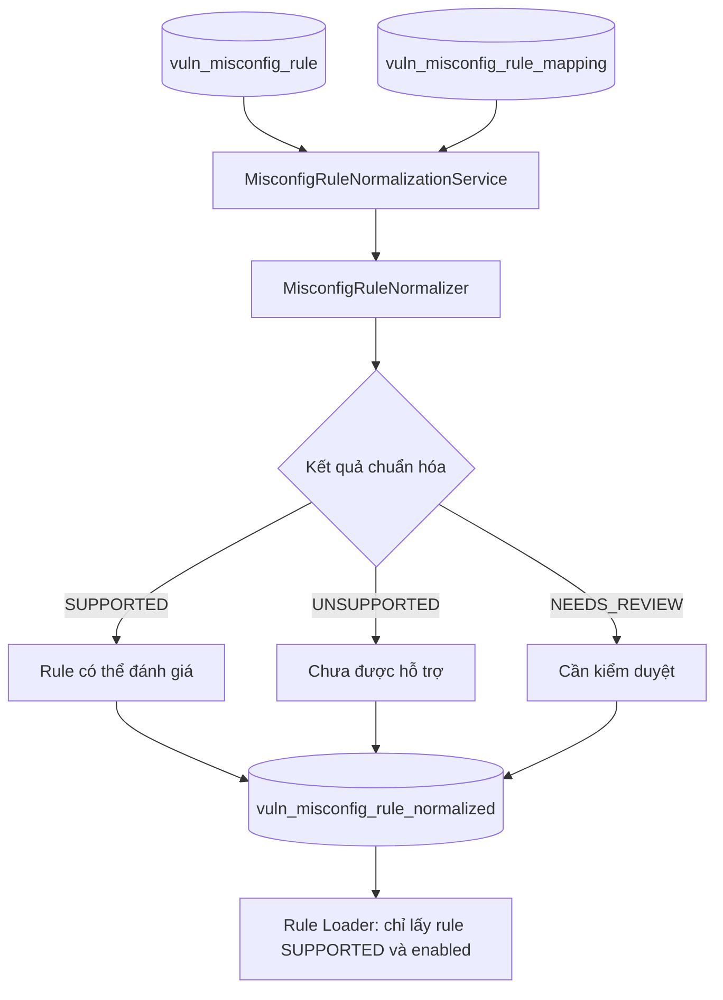

# Mô tả về MISCONFIG_DETECTION

## 1. MISCONFIG_DETECTION là gì?

Misconfiguration Detection (Phát hiện cấu hình không an toàn) là quá trình thu thập thông tin cấu hình của thiết bị, hệ
điều hành hoặc dịch vụ, sau đó đối chiếu với những quy tắc và tiêu chuẩn bảo mật nhằm phát hiện các thiết lập có thể làm
gia tăng nguy cơ mất an toàn thông tin.

Ví dụ:

- Router bật Telnet để quản trị từ xa.
- Website quản trị chỉ hỗ trợ HTTP thay vì HTTPS.
- SNMPv1/v2c cho phép đọc thông tin bằng community mặc định public.
- UPnP cho phép một số hoạt động điều khiển không phù hợp với chính sách mạng.
- SSH Server cho phép các thuật toán mã hóa hoặc trao đổi khóa yếu.
- Giao diện quản trị được truy cập từ vùng mạng không được phép.

Vai trò của MISCONFIG_DETECTION trong hệ thông này:

| Thành phần               | Chức năng                                                                   |
|--------------------------|-----------------------------------------------------------------------------|
| Discovery Service        | Thu thập host, port, service, OS và configuration snapshots                 |
| CVE_MATCHING (F1)        | Tìm CVE tiềm năng dựa trên sản phẩm, phiên bản và điều kiện ảnh hưởng       |
| MISCONFIG_DETECTION (F2) | Phát hiện các thiết lập dịch vụ hoặc thiết bị không đáp ứng quy tắc bảo mật |
| RISK_SCORING (F3)        | Tổng hợp kết quả F1 và F2 để đánh giá, xếp hạng rủi ro                      |
| Platform Service         | Điều phối và hiển thị kết quả assessment                                    |

Ví dụ, một máy chủ không có CVE được tìm thấy vẫn có thể sử dụng Telnet hoặc công khai một giao diện quản trị không cần
thiết. F1 không được thiết kế để phát hiện đầy đủ những vấn đề đó, nhưng F2 có thể phát hiện khi có đủ bằng chứng.

## 2. Các cơ sở lý thuyết liên quan

### 2.1. Security Configuration Baseline

Security Baseline là tập hợp những giá trị và thiết lập bảo mật được chấp thuận cho một nhóm thiết bị hoặc hệ thống

Ví dụ:

- Router Management: Ưu tiên SSH/HTTPS, hạn chế giao thức quản trị không mã hóa
- SNMP: Ưu tiên SNMPv3 với cơ chế bảo mật thích hợp
- SSH: Không cho phép thuật toán yếu theo chính sách được áp dụng
- Firewall: Chỉ cho phép những luồng kết nối cần thiết
- UPnP: Chỉ bật khi có nhu cầu và phạm vi truy cập phù hợp

CIS Controls v8 Control 4 yêu cầu thiết lập và duy trì cấu hình an toàn cho thiết bị và phần mềm; Control 12 đề cập quản
lý an toàn hạ tầng mạng. (https://www.cisecurity.org/controls/cis-controls-navigator/v8)

### 2.2. Rule-based Detection

Đây là cơ sở thuật toán chính tôi đề xuất cho F2. Một quy tắc bảo mật bao gồm:
$$Rule=(Condition,\ Evidence,\ Severity,\ Recommendation)$$

Trong đó:

* Condition: điều kiện xác định cấu hình không an toàn.
* Evidence: dữ liệu thực tế chứng minh điều kiện.
* Severity: mức độ nghiêm trọng theo chính sách.
* Recommendation: hướng khắc phục.

Ví dụ:

```
Rule ID: TELNET_ENABLED

Condition:
  protocol = tcp
  AND service = telnet
  AND port.state = open

Result:
  Finding = INSECURE_MANAGEMENT_PROTOCOL
```

Quy tắc nên lưu dưới dạng YAML/JSON thay vì hardcode trực tiếp trong các câu lệnh if/else của Python. Điều này hỗ trợ bổ
sung kiểm tra mới mà không sửa thuật toán lõi.

### 2.3. Configuration Compliance Checking

Đây là quá trình so sánh trạng thái thực tế của thiết bị với cấu hình chuẩn.

```
Observed Configuration
          |
          v
Security Baseline
          |
          v
Compliance Evaluation
          |
     +----+----+
     |         |
  Compliant  Non-compliant
```

Trong hệ thống quét không có quyền quản trị, cần thêm trạng thái UNKNOWN hoặc NOT_EVALUATED khi chưa có đủ bằng chứng để
đưa ra kết luận. Ví dụ, chỉ phát hiện cổng UDP 161 không có nghĩa community SNMP là public. Phải có bằng chứng Discovery
thực sự nhận được phản hồi phù hợp.

### 2.4. Least Privilege và Attack Surface Reduction

Hai nguyên tắc quan trọng:

* Least Privilege: Chỉ cấp những quyền và khả năng truy cập cần thiết.
* Attack Surface Reduction: Giảm số lượng giao diện, dịch vụ và chức năng có thể bị tấn công.

Ví dụ, thiết bị Router chỉ cần quản trị từ VLAN nội bộ thì không nên để giao diện quản trị truy cập rộng hơn mức cần
thiết.

CISA cũng đưa ra hướng dẫn giảm nguy cơ từ các giao diện quản trị bị phơi lộ ra Internet. Tuy nhiên, khả năng truy cập
trong một mạng LAN không đủ để kết luận giao diện bị phơi lộ ra Internet; cần có bằng chứng về routing, firewall hoặc
một phép kiểm tra từ vị trí phù hợp.

### 2.5. Evidence-based Detection

Mọi cảnh báo cấu hình nên đi kèm bằng chứng cụ thể, ví dụ:

```
{
  "rule_id": "HTTP_MANAGEMENT",
  "host": "192.168.56.12",
  "port": 80,
  "evidence": {
    "http_status": 200,
    "html_title": "Router Administration",
    "management_interface": true
  }
}
```

Đây là ví dụ dữ liệu mong muốn. Trong thực tế, tiêu đề trang chỉ là một dấu hiệu; cần tiêu chí nhận diện giao diện quản
trị có thể kiểm chứng trước khi kết luận.

Nguyên tắc quan trọng của F2 là không có bằng chứng không đồng nghĩa với cấu hình an toàn.

## Data flow trong bước MISCONFIG_DETECTION

### Pull dữ liệu ComplianceAsCode về database PostgreSQL

Trong hệ thống LAN Vulnerability Scanner, quá trình chuẩn hóa quy tắc bảo mật (Misconfiguration Rule Normalization) được
xây dựng nhằm chuyển đổi các quy tắc cấu hình an toàn từ dự án ComplianceAsCode thành một cấu trúc dữ liệu thống nhất,
phù hợp với khả năng thu thập bằng chứng của Discovery Service và khả năng đánh giá của MISCONFIG_DETECTION. Quá trình
này không chỉ trích xuất thông tin mô tả của quy tắc mà còn xác định liệu quy tắc đó có đủ điều kiện để được thực thi
trong hệ thống hay không.

Quá trình xử lý được tổ chức thành hai giai đoạn chính: đồng bộ dữ liệu quy tắc gốc và chuẩn hóa quy tắc dựa trên bảng
ánh xạ đã được kiểm duyệt.

Ví dụ:

- ComplianceAsCode định nghĩa: SSH không được cho phép đăng nhập trực tiếp bằng tài khoản root.
- Vulnerability Service đọc quy tắc đó.
- Chuyển các thông tin như tên, mô tả, mức độ nghiêm trọng, điều kiện kiểm tra sang cấu trúc nội bộ.
- Lưu vào bảng vuln_misconfig_rule.
- Khi quét thiết bị, MISCONFIG_DETECTION lấy rule ra để đối chiếu với bằng chứng Discovery thu thập được.

Đây là sơ đồ hoạt động của flow này:



#### 1. Đồng bộ và phân tích dữ liệu quy tắc gốc

Hệ thống sử dụng MisconfigRuleSync trong auto_fetch_rule/sync.py để điều phối việc đồng bộ dữ liệu từ repository
ComplianceAsCode trên GitHub. Module MisconfigRuleFetcher chịu trách nhiệm tải hoặc cập nhật repository, xác định Git
revision và tìm kiếm các file rule.yml

Sau đó, MisconfigRuleParser đọc từng file YAML, kiểm tra cấu trúc và trích xuất các thuộc tính quan trọng như mã quy
tắc, tên, mô tả, lý do áp dụng, mức độ nghiêm trọng, nền tảng áp dụng, các tiêu chuẩn tham chiếu và khả năng khắc phục.

Các giá trị được chuyển đổi về định dạng thống nhất. Chẳng hạn, mức độ nghiêm trọng được chuẩn hóa thành NONE, LOW,
MEDIUM, HIGH, CRITICAL hoặc UNKNOWN; thông tin tham chiếu được chuyển thành danh sách JSON; dữ liệu gốc được giữ lại
trong raw_data và raw_content.

Ngoài ra, hệ thống sử dụng hàm băm SHA-256 để nhận diện nội dung của từng quy tắc. Các file có cấu trúc không thể phân
tích đầy đủ vẫn được lưu dưới trạng thái RAW_ONLY, trong khi những quy tắc chứa biểu thức template chưa được xử lý hoàn
chỉnh có thể mang trạng thái PROVISIONAL.

Dữ liệu sau phân tích được lưu vào bảng vuln_misconfig_rule trong PostgreSQL, đồng thời giữ các thông tin về nguồn,
phiên bản và trạng thái xử lý để phục vụ truy vết, kiểm tra và đồng bộ về sau.

#### 2. Chuẩn hóa quy tắc dựa trên Rule Mapping

Sau khi dữ liệu gốc được lưu thành công, hệ thống sử dụng `MisconfigRuleNormalizationService` trong
`normalize_service.py` để thực hiện chuẩn hóa. Thành phần này lấy các quy tắc đã lưu và tìm kiếm bản ánh xạ tương ứng
trong bảng `vuln_misconfig_rule_mapping`.

Việc liên kết giữa quy tắc gốc và bản ánh xạ được thực hiện dựa trên ba thuộc tính:

- `source_id`: định danh nguồn dữ liệu.
- `source_file`: đường dẫn file quy tắc.
- `content_sha256`: hàm băm nội dung quy tắc.

Cách liên kết này giúp bảo đảm bản ánh xạ đang sử dụng tương ứng với đúng nội dung quy tắc đã được phân tích, hạn chế sử
dụng nhầm ánh xạ khi ComplianceAsCode thay đổi nội dung.

Trước khi chuyển đổi, `MisconfigRuleNormalizer` trong `mapping_rule_normalizer.py` kiểm tra trạng thái của quy tắc và
bản ánh xạ. Cụ thể, bản ánh xạ phải có trạng thái `REVIEWED`, được bật sử dụng và khớp với nguồn dữ liệu. Sau đó, hệ
thống kiểm tra cấu trúc các thành phần `target, applicability, condition và required_evidence`.

Quy tắc đã chuẩn hóa được biểu diễn dưới dạng JSON với các thành phần chính:

| Thành phần          | Chức năng                                                       |
|---------------------|-----------------------------------------------------------------|
| `source`            | Lưu thông tin truy xuất về quy tắc ComplianceAsCode gốc         |
| `evaluation_type`   | Xác định loại phép kiểm tra cấu hình                            |
| `target`            | Xác định đối tượng cần đánh giá                                 |
| `applicability`     | Mô tả điều kiện áp dụng quy tắc                                 |
| `condition`         | Biểu diễn điều kiện để Rule Engine đánh giá                     |
| `required_evidence` | Xác định những dữ liệu Discovery phải cung cấp                  |
| `result_mapping`    | Quy định cách chuyển kết quả kiểm tra thành trạng thái đánh giá |

Đặc biệt, hệ thống không tự động chuyển mọi quy tắc ComplianceAsCode thành quy tắc có thể thực thi. Trong mã nguồn hiện
tại, `MisconfigRuleNormalizer` chỉ công nhận toán tử `SERVICE_PRESENT` thuộc loại đánh giá `SERVICE_EXPOSURE` khi thỏa
mãn đầy đủ các điều kiện kiểm tra, bao gồm xác minh ngữ nghĩa quy tắc gốc, phạm vi hệ điều hành và khả năng cung cấp
bằng chứng của Discovery Service.

Các toán tử khác như `SSH_EFFECTIVE_CONFIG`, `SERVICE_ENABLED`, `PACKAGE_INSTALLED` hay `SYSCTL_EQUALS` đã xuất hiện
trong dữ liệu ánh xạ mẫu nhưng chưa thuộc danh sách toán tử được hỗ trợ bởi bộ chuẩn hóa hiện tại.

#### 3. Phân loại khả năng thực thi và lưu kết quả chuẩn hóa

Quy tắc được phân loại theo khả năng thực thi:

| Trạng thái      | Ý nghĩa                                                                                                         |
|-----------------|-----------------------------------------------------------------------------------------------------------------|
| `SUPPORTED`     | Quy tắc có ánh xạ hợp lệ, được xác minh và đáp ứng các điều kiện mà Rule Engine hỗ trợ                          |
| `UNSUPPORTED`   | Chưa có ánh xạ phù hợp, toán tử chưa được hỗ trợ hoặc Discovery không cung cấp đủ loại bằng chứng cần thiết     |
| `NEEDS_REVIEW`  | Quy tắc hoặc bản ánh xạ cần được kiểm tra, xác minh thêm                                                        |
| `NOT_PROCESSED` | Quy tắc chưa trải qua quá trình chuẩn hóa                                                                       |
| `INVALID`       | Trạng thái lỗi được định nghĩa trong cơ sở dữ liệu, nhưng không phải kết quả được hàm chuẩn hóa hiện tại trả về |

Kết quả chuẩn hóa được ghi nhận thông qua `MisconfigRuleRepository`. Mã nguồn sử dụng bảng
`vuln_misconfig_rule_normalized` để lưu biểu diễn quy tắc sau ánh xạ, đồng thời bảng `vuln_misconfig_rule` lưu metadata,
dữ liệu gốc và các trường trạng thái chuẩn hóa.

các bản ghi chuẩn hóa được lưu với `enabled = FALSE`. Do đó, việc một quy tắc được xác định là `SUPPORTED` không đồng
nghĩa với việc quy tắc đó đã được kích hoạt để tham gia đánh giá thiết bị. Việc kích hoạt phải được thực hiện theo cơ
chế quản lý quy tắc riêng

#### 4. Sử dụng quy tắc trong MISCONFIG_DETECTION

Khi bước `MISCONFIG_DETECTION` được thực thi, `MisconfigRuleLoader` trong `detection/rule_loader.py` truy vấn các quy
tắc chuẩn hóa đã được kích hoạt, đồng thời kiểm tra sự tồn tại của condition và required_evidence trước khi cung cấp cho
Rule Engine.

Rule Engine sử dụng thông tin cấu hình do Discovery Service thu thập để đánh giá các điều kiện đã chuẩn hóa. Với những
trường hợp không có đủ bằng chứng, hệ thống cần duy trì trạng thái chưa xác định thay vì mặc định kết luận rằng thiết bị
an toàn hoặc vi phạm.

#### 5. Lưu ý

Ở phiên bản hiện tại, khả năng chuẩn hóa thành quy tắc thực thi còn giới hạn ở nhóm kiểm tra sự hiện diện của dịch vụ (
SERVICE_PRESENT). Những quy tắc yêu cầu truy cập trực tiếp cấu hình SSH, trạng thái package hoặc tham số kernel vẫn cần
được phát triển thêm cơ chế thu thập bằng chứng và toán tử tương ứng trước khi có thể áp dụng trong MISCONFIG_DETECTION.

## Phân tích nguồn dữ liệu ComplianceAsCode phục vụ phát hiện lỗi cấu hình bảo mật

### Tổng quan về nguồn dữ liệu ComplianceAsCode

ComplianceAsCode là một dự án mã nguồn mở cung cấp tập hợp các nội dung kiểm tra tuân thủ và cấu hình bảo mật cho hệ
điều hành, ứng dụng và một số nền tảng công nghệ. Dự án hướng đến việc biểu diễn các yêu cầu bảo mật thành những quy tắc
có cấu trúc, hỗ trợ đánh giá trạng thái cấu hình và hướng dẫn khắc phục những thiết lập không đáp ứng chính sách an
toàn.

Nguồn dữ liệu của dự án được quản lý trên GitHub tại ComplianceAsCode/content (link:
https://github.com/ComplianceAsCode/content?utm_source=chatgpt.com), trong đó các quy tắc được tổ chức theo hệ
điều hành, nhóm chức năng và thành phần phần mềm. ComplianceAsCode sử dụng các file YAML để định nghĩa nội dung quy tắc,
đồng thời hỗ trợ những thành phần kiểm tra và khắc phục bằng OVAL, Bash và Ansible. Từ nguồn nội dung này, dự án có thể
xây dựng các tài liệu và nội dung kiểm tra tương thích với hệ sinh thái SCAP, đặc biệt là XCCDF và OVAL

Trong hệ thống LAN Vulnerability Scanner, ComplianceAsCode được lựa chọn làm nguồn tri thức bảo mật đầu vào cho
`MISCONFIG_DETECTION (F2)`. Khác với cơ sở dữ liệu CVE dùng để nhận diện các lỗ hổng đã được công bố, ComplianceAsCode
tập trung mô tả trạng thái cấu hình mong muốn, những yêu cầu bảo mật cần được đáp ứng và phương pháp kiểm tra tương ứng

Việc sử dụng nguồn dữ liệu này giúp hệ thống xây dựng tập hợp quy tắc có nguồn gốc rõ ràng, có thể đồng bộ và mở rộng mà
không phải định nghĩa thủ công toàn bộ thông tin bảo mật từ đầu.

### Cấu trúc tổ chức dữ liệu ComplianceAsCode

ComplianceAsCode tổ chức dữ liệu theo cấu trúc phân cấp. Các quy tắc bảo mật thường nằm trong thư mục tương ứng với một
nhóm chức năng, trong đó mỗi quy tắc có một thư mục riêng chứa file định nghĩa `rule.yml` và các thành phần hỗ trợ kiểm
tra hoặc khắc phục.

Ví dụ cấu trúc của một quy tắc:

```text
ComplianceAsCode/content/
└── linux_os/
    └── guide/
        └── services/
            └── ssh/
                └── ssh_server/
                    └── <rule_id>/
                        ├── rule.yml
                        ├── oval/
                        │   └── shared.xml
                        ├── bash/
                        │   └── shared.sh
                        ├── ansible/
                        │   └── shared.yml
                        └── tests/
```

Trong đó, `rule.yml` là thành phần trung tâm, lưu thông tin mô tả và các thuộc tính của quy tắc. Những thư mục như
`oval`, `bash`, `ansible` chứa nội dung kiểm tra hoặc hướng dẫn khắc phục tương ứng với các cơ chế được hỗ trợ

Các thành phần dữ liệu chính của một Rule bao gồm:

| Trường dữ liệu | Ý nghĩa                                  | Vai trò trong hệ thống             |
|----------------|------------------------------------------|------------------------------------|
| `title`        | Tên quy tắc bảo mật                      | Hiển thị tên quy tắc               |
| `description`  | Mô tả cấu hình yêu cầu                   | Xác định nội dung cần kiểm tra     |
| `rationale`    | Giải thích lý do bảo mật                 | Cung cấp cơ sở đánh giá            |
| `severity`     | Mức độ nghiêm trọng                      | Phân loại mức độ vi phạm           |
| `identifiers`  | Định danh như CCE                        | Liên kết với hệ thống định danh    |
| `references`   | Tham chiếu tiêu chuẩn bảo mật            | Truy vết cơ sở quy tắc             |
| `platform`     | Điều kiện nền tảng áp dụng               | Lựa chọn thiết bị phù hợp          |
| `ocil`         | Hướng dẫn kiểm tra thủ công              | Tham khảo phương pháp xác minh     |
| `fixtext`      | Hướng dẫn khắc phục                      | Hỗ trợ đề xuất remediation         |
| `template`     | Khai báo mẫu nội dung kiểm tra/khắc phục | Phục vụ xây dựng logic chuyên biệt |

### Đặc điểm của nguồn dữ liệu ComplianceAsCode

Thứ nhất, dữ liệu mang tính quy tắc và định hướng tuân thủ. Mỗi rule mô tả một yêu cầu cấu hình hoặc trạng thái bảo mật
mong muốn. Ví dụ, các quy tắc liên quan đến SSH có thể yêu cầu vô hiệu hóa một phương thức đăng nhập không an toàn hoặc
áp dụng chính sách xác thực cụ thể. Những yêu cầu này có thể được sử dụng để xác định điều kiện đánh giá trong
`MISCONFIG_DETECTION`

Thứ hai, dữ liệu có tính phụ thuộc vào nền tảng. Một quy tắc chỉ có ý nghĩa khi áp dụng đúng hệ điều hành, phiên bản
phần mềm hoặc môi trường đã được định nghĩa. Các thuộc tính platform, định danh theo sản phẩm và security profile đóng
vai trò xác định phạm vi áp dụng. Vì vậy, không thể mặc định tất cả quy tắc được tải về đều phù hợp với mọi thiết bị
trong mạng LAN.

Thứ ba, dữ liệu có nhiều phương thức kiểm tra. Một số rule có thể được kiểm tra bằng các thuộc tính quan sát được từ xa,
trong khi nhiều rule khác yêu cầu truy cập file cấu hình, trạng thái package, dịch vụ hệ thống hoặc các tham số kernel.
Trong các trường hợp này, thông tin thu thập bằng Nmap hay HTTP banner đơn thuần không đủ để thực thi quy tắc.

Do đó, ComplianceAsCode là một nguồn dữ liệu có giá trị về mặt kiến thức bảo mật, nhưng không phải cơ sở dữ liệu rule có
thể áp dụng trực tiếp cho mọi hình thức quét mạng từ xa.

### Khả năng tích hợp ComplianceAsCode vào Vulnerability Service

Hệ thống hiện triển khai cơ chế tích hợp thông qua các module `MisconfigRuleFetcher`, `MisconfigRuleParser`,
`MisconfigRuleSync` và `MisconfigRuleNormalizer`.

Đầu tiên, `MisconfigRuleFetcher` tải và đồng bộ repository ComplianceAsCode bằng Git, sau đó tìm kiếm các file
`rule.yml` trong phạm vi thư mục cấu hình. `MisconfigRuleParser` đọc YAML, trích xuất metadata, chuẩn hóa mức độ nghiêm
trọng, định danh, tham chiếu và lưu lại nội dung gốc cùng mã băm SHA-256. Những rule chứa biểu thức chưa được xử lý hoàn
toàn được đánh dấu `PROVISIONAL`; trường hợp không thể phân tích đầy đủ có thể được lưu dưới dạng `RAW_ONLY`.

Các dữ liệu này được đồng bộ vào PostgreSQL thông qua bảng `vuln_misconfig_rule`, tạo thành kho lưu trữ quy tắc bảo mật
có thể quản lý, truy xuất và cập nhật theo phiên bản nguồn.

Tiếp theo, hệ thống sử dụng bảng `vuln_misconfig_rule_mapping` để ánh xạ quy tắc gốc sang cấu trúc đánh giá nội bộ. Quá
trình chuẩn hóa kiểm tra thông tin nguồn, mã băm nội dung, trạng thái kiểm duyệt, nền tảng áp dụng và bằng chứng cần
thiết trước khi xác định một quy tắc có được hỗ trợ hay không.

### Phân tích quá trình Parser chuyển đổi dữ liệu ComplianceAsCode sang bảng vuln_misconfig_rule

#### Bước 1 — Kiểm tra file nguồn và xác định nguồn gốc rule

Ban đầu, Parser kiểm tra:

- Đường dẫn có tồn tại và là file hay không.
- Tên file có chính xác là rule.yml hay không.
- File có thuộc repository ComplianceAsCode đã cấu hình hay không.
- Git revision có được cung cấp hay không.

Sau đó, Parser lấy đường dẫn tương đối của file trong repository và xây dựng URL GitHub tham chiếu đến đúng revision.

Ví dụ minh họa:

```text
Repository:
ComplianceAsCode/content

Rule:
linux_os/guide/services/ssh/ssh_server/sshd_disable_root_login/rule.yml

Revision:
abc123...
```

Dữ liệu được chuyển thành:

```text
{
  "external_rule_id": "sshd_disable_root_login",
  "source_revision": "abc123...",
  "source_file": "linux_os/guide/services/ssh/ssh_server/sshd_disable_root_login/rule.yml",
  "source_reference_url": "https://github.com/ComplianceAsCode/content/blob/abc123.../linux_os/guide/services/ssh/ssh_server/sshd_disable_root_login/rule.yml"
}
```

#### Bước 2 — Đọc nội dung gốc và tính SHA-256

Parser sử dụng:

```python
content_bytes = path.read_bytes()
raw_content = content_bytes.decode("utf-8-sig")
content_sha256 = hashlib.sha256(content_bytes).hexdigest()
```

Trong đó:

- `raw_content`: Nội dung YAML nguyên bản giúp Phục vụ kiểm tra và phân tích lại
- `content_sha256`: SHA-256 của byte nội dung file giúp Nhận diện chính xác phiên bản nội dung

#### Bước 3 — Tiền xử lý cú pháp template

Parser gọi:

```python
yaml_content, contains_template = self._prepare_yaml(raw_content)
```

#### Bước 4 — Phân tích YAML thành Python dictionary

```python
parsed = yaml.safe_load(yaml_content)
```

#### Bước 5 — Trích xuất và chuẩn hóa metadata

* Chuẩn hóa văn bản: chỉ chấp nhận chuỗi và loại bỏ khoảng trắng ở đầu/cuối
* Chuẩn hóa Severity: Chuẩn hóa về chữ in hoa
* Chuẩn hóa References: chuyển thành danh sách object
* Chuẩn hóa Identifiers và Platform: chỉ giữ dữ liệu khi identifiers là dictionary, chuyển các key thành chuỗi nhưng giữ
  nguyên giá trị.

#### Bước 6 — Xây dựng bản ghi phù hợp với `vuln_misconfig_rule`

| Trường PostgreSQL       | Nguồn dữ liệu trong Parser      | Cách xử lý                             |
|-------------------------|---------------------------------|----------------------------------------|
| `external_rule_id`      | Tên thư mục cha của `rule.yml`  | Giữ nguyên                             |
| `source_revision`       | Git revision                    | Giữ nguyên                             |
| `source_file`           | Đường dẫn tương đối             | Chuẩn hóa dấu phân cách thành `/`      |
| `source_reference_url`  | Repository URL, revision, path  | Tạo URL tham chiếu                     |
| `title`                 | `title`                         | Trim, bắt buộc                         |
| `description`           | `description`                   | Trim hoặc NULL                         |
| `rationale`             | `rationale`                     | Trim hoặc NULL                         |
| `severity`              | `severity`                      | Uppercase, kiểm tra tập giá trị        |
| `identifiers`           | `identifiers`                   | Dictionary JSON                        |
| `references_data`       | `references`                    | Chuyển thành danh sách `{type, value}` |
| `platform_expression`   | `platform`                      | Chỉ lấy nếu là chuỗi                   |
| `remediation_available` | Thư mục `bash/` hoặc `ansible/` | Boolean                                |
| `raw_format`            | Do Parser quy định              | YAML                                   |
| `raw_data`              | YAML đã parse                   | Dictionary JSON                        |
| `raw_content`           | Byte file được giải mã          | Nội dung YAML gốc                      |
| `content_sha256`        | Byte file gốc                   | SHA-256                                |
| `parse_status`          | Kết quả parse                   | `PARSED` hoặc `PROVISIONAL`            |
| `contains_template`     | `_prepare_yaml()`               | Boolean                                |
| `parser_error`          | Kết quả parse                   | NULL nếu parse thành công              |
| `normalized_rule`       | Chưa xử lý                      | NULL                                   |
| `required_evidence`     | Chưa xử lý                      | `[]`                                   |
| `execution_status`      | Chưa chuẩn hóa                  | `NOT_PROCESSED`                        |
| `enabled`               | Giá trị mặc định                | FALSE                                  |
| `deprecated`            | Giá trị mặc định                | FALSE                                  |

### Phân tích quá trình chuẩn hóa từ `vuln_misconfig_rule` sang `vuln_misconfig_rule_normalized`

Quá trình chuẩn hóa quy tắc bảo mật được thực hiện bởi hai thành phần chính:

* `MisconfigRuleNormalizationService` trong `normalization/normalize_service.py`: điều phối việc đọc, đối chiếu và lưu
  dữ liệu.
* `MisconfigRuleNormalizer` trong `normalization/mapping_rule_normalizer.py`: kiểm tra bản ánh xạ và tạo biểu diễn quy
  tắc mà Rule Engine có thể hiểu.

Bản chất của quá trình này không phải tự động dịch toàn bộ quy tắc ComplianceAsCode thành Python hoặc JSON thực thi
được. Thay vào đó, hệ thống sử dụng một bảng ánh xạ trung gian đã được kiểm duyệt để xác định quy tắc nào có thể áp dụng
bằng dữ liệu Discovery hiện tại

**Vai trò của ba bảng dữ liệu**

| Bảng                             | Vai trò                    | Nội dung chính                                                       |
|----------------------------------|----------------------------|----------------------------------------------------------------------|
| `vuln_misconfig_rule`            | Lưu quy tắc nguồn          | Metadata, YAML gốc, SHA-256, phiên bản, trạng thái parse             |
| `vuln_misconfig_rule_mapping`    | Định nghĩa cách chuyển đổi | Đối tượng kiểm tra, điều kiện áp dụng, toán tử, bằng chứng cần thiết |
| `vuln_misconfig_rule_normalized` | Lưu quy tắc sau chuẩn hóa  | Điều kiện đánh giá, trạng thái hỗ trợ, cấu trúc JSON cho Rule Engine |

Ví dụ, ComplianceAsCode có một quy tắc yêu cầu kiểm soát dịch vụ Telnet. Bảng `vuln_misconfig_rule` lưu thông tin của
quy tắc đó. Bảng `vuln_misconfig_rule_mapping` xác định liệu yêu cầu ấy có thể được biểu diễn bằng điều kiện
`SERVICE_PRESENT` hay không. Nếu bản ánh xạ đã được xác minh, hệ thống tạo bản ghi trong
`vuln_misconfig_rule_normalized`.



### 2. Quy trình chuẩn hóa trong mã nguồn

#### Bước 1 — Đọc các quy tắc gốc

Trong `MisconfigRuleNormalizationService.run()`, hệ thống gọi:

```python
rules = self.repository.get_raw_normalized_rules(
    revision=revision,
    source_files=source_files
)
```

Phương thức này đọc các quy tắc theo Git revision và danh sách đường dẫn file từ `vuln_misconfig_rule`.
Mỗi bản ghi là một quy tắc ComplianceAsCode đã được Parser lưu vào database.

#### Bước 2 — Tìm bản ánh xạ phù hợp

Hệ thống gọi: `mappings = self.repository.get_mappings_for_rules(rules)`

Phương thức repository chỉ lấy các mapping: `WHERE m.verification_status = 'REVIEWED' AND m.enabled = TRUE`

#### Bước 3 — Kiểm tra rule nguồn và mapping

`MisconfigRuleNormalizer.normalize(rule, mapping)` thực hiện các kiểm tra theo thứ tự:

| Điều kiện                                             | Kết quả nếu không đạt |
|-------------------------------------------------------|-----------------------|
| Rule nguồn không bị deprecated                        | `UNSUPPORTED`         |
| `parse_status` là `PARSED` hoặc `PROVISIONAL`         | `NEEDS_REVIEW`        |
| Có mapping                                            | `UNSUPPORTED`         |
| Mapping được `REVIEWED` và `enabled`                  | `NEEDS_REVIEW`        |
| `source_id`, `source_file`, `content_sha256` khớp     | `NEEDS_REVIEW`        |
| `target`, `applicability`, `condition` là JSON object | `NEEDS_REVIEW`        |
| `required_evidence` là danh sách chuỗi                | `NEEDS_REVIEW`        |

Các bước này đảm bảo không sử dụng quy tắc thiếu metadata hoặc một bản ánh xạ chưa được phê duyệt.

#### Bước 4 — Tạo cấu trúc `normalized_rule`

Sau khi các kiểm tra ban đầu hợp lệ, `MisconfigRuleNormalizer` tạo dictionary normalized:

```python
normalized = {
    "schema_version": "1.0",
    "source": {
        "provider": "COMPLIANCE_AS_CODE",
        "rule_id": rule["external_rule_id"],
        "source_file": rule["source_file"],
        "source_revision": rule["source_revision"],
        "content_sha256": rule["content_sha256"],
    },
    "mapping_id": mapping["id"],
    "evaluation_type": mapping["evaluation_type"],
    "target": deepcopy(mapping["target"]),
    "applicability": deepcopy(mapping["applicability"]),
    "condition": deepcopy(mapping["condition"]),
    "required_evidence": list(mapping["required_evidence"]),
    "result_mapping": {
        "positive": "MATCH",
        "negative": "UNKNOWN",
        "missing": "UNKNOWN",
    },
}
```

Đây là sản phẩm chính của bước chuẩn hóa. Nó kết hợp thông tin truy vết từ rule gốc với điều kiện thực thi lấy từ
mapping.

Trong đó:

| Thành phần          | Ý nghĩa                                    |
|---------------------|--------------------------------------------|
| `schema_version`    | Phiên bản cấu trúc JSON nội bộ             |
| `source`            | Truy vết về quy tắc ComplianceAsCode       |
| `mapping_id`        | Xác định mapping được sử dụng              |
| `evaluation_type`   | Loại phép đánh giá                         |
| `target`            | Loại đối tượng cần kiểm tra                |
| `applicability`     | Điều kiện xác định đối tượng được áp dụng  |
| `condition`         | Điều kiện kỹ thuật mà Rule Engine kiểm tra |
| `required_evidence` | Những trường Discovery phải cung cấp       |
| `result_mapping`    | Cách biểu diễn kết quả đánh giá            |

#### Bước 5 — Kiểm tra khả năng thực thi

Sau khi xây dựng normalized_rule, hệ thống chưa lập tức đánh dấu SUPPORTED. Nó tiếp tục kiểm tra Rule Engine có thực sự
xử lý được điều kiện hay không.

Như vậy, phiên bản Normalizer hiện tại chỉ hỗ trợ một toán tử là `SERVICE_PRESENT`.

Đối với toán tử này, mapping còn phải đáp ứng các điều kiện:
- evaluation_type = `SERVICE_EXPOSURE`.
- target.type = HOST.
- condition.protocol là tcp hoặc udp.
- condition.service_names là danh sách không rỗng gồm các tên dịch vụ hợp lệ.
- Không chứa trường condition.product_names.
- Có đủ các trường bằng chứng bắt buộc.
- Xác nhận source_semantics_verified = true.
- Xác nhận applicability.verified = true và có danh sách os_families.

Ví dụ minh họa một mapping:
```json
{
  "evaluation_type": "SERVICE_EXPOSURE",
  "target": {
    "type": "HOST"
  },
  "applicability": {
    "verified": true,
    "os_families": ["linux"]
  },
  "condition": {
    "operator": "SERVICE_PRESENT",
    "protocol": "tcp",
    "service_names": ["telnet"],
    "source_semantics_verified": true
  },
  "required_evidence": [
    "devices[].ip",
    "devices[].os.name",
    "devices[].ports[].protocol",
    "devices[].ports[].service.name"
  ]
}
```
